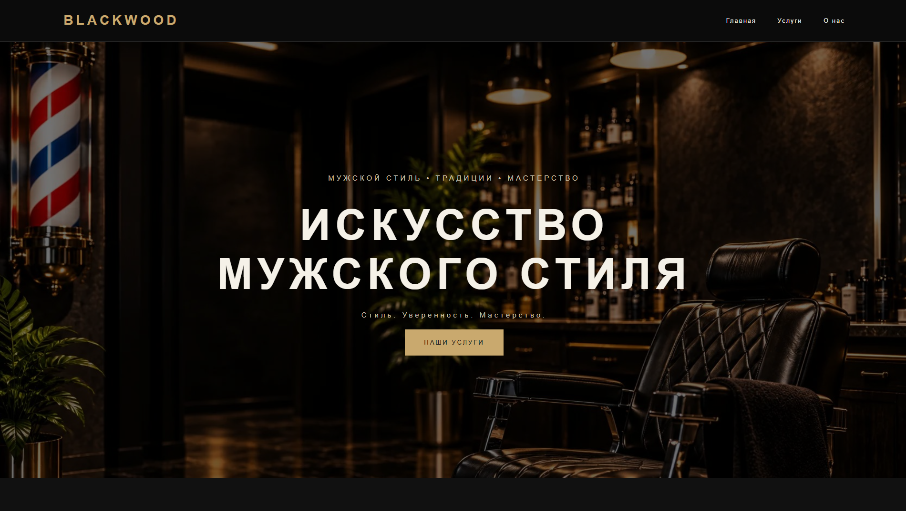

BLACKWOOD — Barbershop Website

A premium barbershop website built as a personal learning and portfolio project.

Technologies

- Python
- Flask
- HTML
- CSS
- SQLite
- JavaScript

Features

- Premium dark design with gold accents
- Responsive layout for desktop and mobile
- Services and pricing section
- About section
- Demonstration booking form (does not send or save personal data)
- Admin dashboard for learning purposes

Project Status

Educational project. Not intended for real customer bookings or production use.
## Preview

